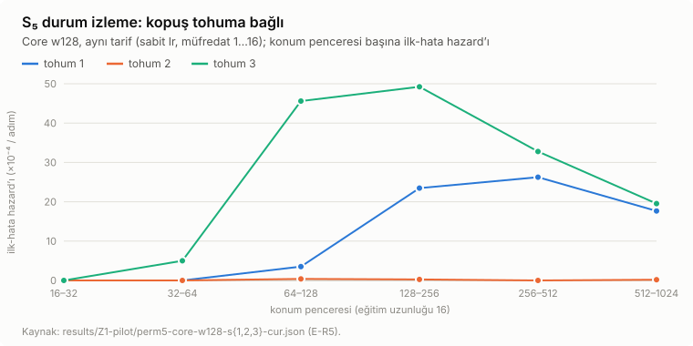
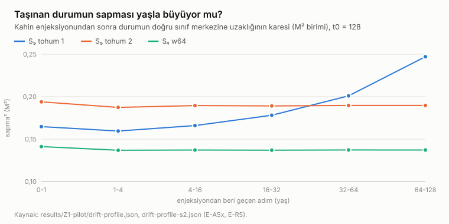
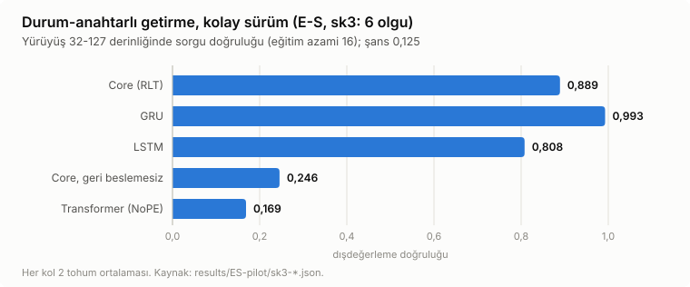
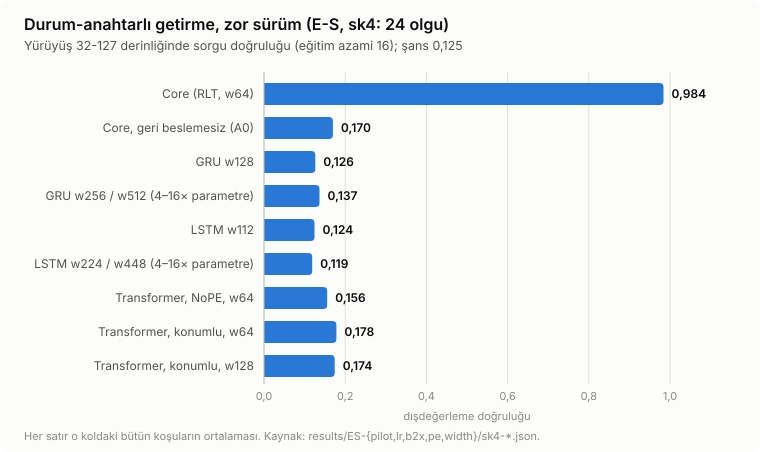
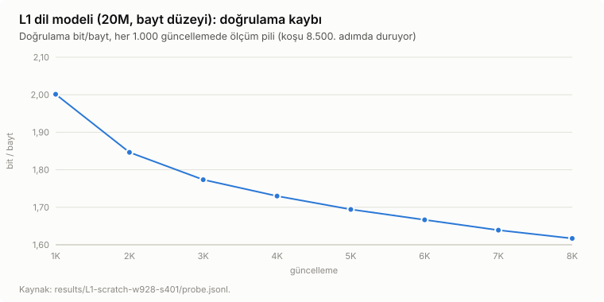
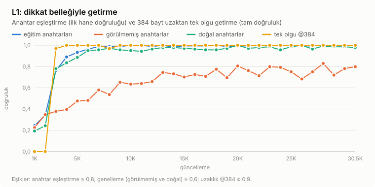
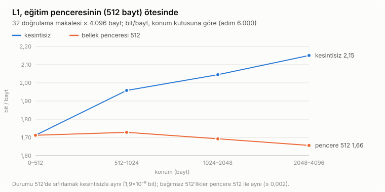

<!-- yayin-readme: bu dosya GitHub ön sayfasıdır; tablolar scripts/make_readme_figures.py ile üretilir -->
# RLT ve başlık belleği — ham veri, sonuçlar, kod ve testler

Bu depo, *Recurrent Looped Transformer* (RLT) ve çevresinde kurulan "başlık belleği" üzerine yürütülen yerel araştırmanın **ham sonuçlarını, istatistiklerini, kodunu ve testlerini** içerir. Planlar, devir notları, ajan defterleri ve `audit/` altındaki mühür kayıtları bu sürümde yoktur.

**English summary.** Raw results, statistics, code and tests of a local research study on the Recurrent Looped Transformer (RLT) and a "heading memory" built around it. Plans, hand-off notes, agent ledgers and the seal records under `audit/` were removed; machine-specific paths were replaced by placeholders. The code is kept as a readable record: parts of it read protocol digests from `*.sha256` files that no longer exist (see below).

## Klasörler

| Klasör | İçerik |
|---|---|
| `results/` | Ham sonuçlar (JSON, JSONL, log): R1, U1–U5, B1/B2, D1, G0, M0/M1, `M1-finetune-distance` (D1–D6 ve T1 serisi), drift, `review-diagnostics-r6`, `training` |
| `core/`, `learning/`, `memory/` | Birinci aşama paketlerinin kodu, günlükleri ve sonuçları (`core/results`, `learning/results`, `learning/distillation`, `memory/results*`, `memory/heading-results`) |
| `horizon/`, `language/`, `semantic_memory/` | Paket kodları |
| `integration/` | Bağlı sistem, akıl yürütme eşlikçisi ve ölçek sonuçları (`connected/`, `reasoning-companion/`, `scale/`) ve onları üreten kod |
| `mline/` | M hattı (needle / MQAR / decoy) kodu |
| `drift/`, `review_cycle/`, `protocols/`, `archive/`, `scripts/` | Kod ve çalıştırma betikleri |
| `tests/` | Testler (ayrıca `drift/test_drift.py` ve `review_cycle/` içindeki testler) |
| `audit/` | Bağımsız denetim sonuçları (JSON/JSONL), denetim betikleri ve yukarı akış projenin kaynak belgeleri (`audit/sources/`) |
| `reports/`, `notes/` | Sonuç raporları, şekiller ve ana belge (`reports/RLT_SONUC_RAPORU.md`, `notes/ANA_BELGE_RLT.md`) |

## Bilmeniz gerekenler

- **Yollar nötrleştirildi.** Dosyalardaki yerel makine yolları yer tutuculara çevrildi: `__RLT_ROOT__` (çalışma kökü), `__PY_ENV_DIR__` (Python ortamının bulunduğu dizin), `__WORKSPACE__` ve `__USER_HOME__`. Betikleri çalıştırmadan önce bunları kendi dizinlerinizle değiştirin. Sonuç dosyalarındaki sayılara dokunulmadı, yalnızca yol yazıları değişti.
- **Kaldırılanlar:** planlar ve tasarım belgeleri, devir notları, ajan defterleri, ön-inceleme ve denetim yazıları; `audit/` altındaki mühür/manifest/doğrulama kayıtları ve kırmızı/yeşil test günlükleri; tüm `*.sha256` yan dosyaları. Paket klasörlerindeki çalıştırma kayıtları (`frozen.json`, `receipt.json`, `manifest.json`, `*-seals.jsonl`) ve konsol/test günlükleri sonuç verisi olarak kaldı; içlerinde yazılı SHA-256 değerleri artık değişen ya da silinen dosyalarla eşleşmez.
- **Çalışmayan kod yolları:** protokol özetini silinen `*.sha256` dosyalarından okuyan kod (`core/benchmark.py`, `core/diagnostics.py`, `core/run_final_only.py`, `core/safe_entrypoint.py`, `learning/distillation/postprocess.py`) çalıştırılırsa `FileNotFoundError` verir. Kod okunabilir kayıt olarak durur; deneyleri yeniden üretmek için eski commit'lere dönmek gerekir.
- **Depoda olmayanlar:** model ağırlıkları (`.pt`), tahmin dizileri (`.npz`) ve SQLite arşivleri Git'e hiç girmedi. Bunlara dayanan hesaplar yeniden üretilemez; yalnızca özet JSON/JSONL sonuçlar vardır.
- **Testler:** `python -m pytest tests review_cycle drift` (Python 3.11, numpy, torch; CPU). Bu sürümde 660 testin 640'ı geçer. 13 test başarısız olur: 8'i bir ayrıştırıcı kontrol noktasına, 3'ü ham metin derlemine, 1'i bir değerlendirme kontrol noktasına, 1'i (`tests/test_sep_finetune.py`) bir kontrol noktasına ve silinen bir `*.sha256` dosyasına bağlıdır. 7 test, ilgili dosya yoksa atlanır.

<!-- TABLES:BEGIN -->

## Özet sonuçlar: tablolar ve grafikler

Tablolar ve grafikler `scripts/make_readme_figures.py` ile ham sonuç dosyalarından hesaplanır; yalnızca kayıtlı okuma kuralıyla okunmuş ve `notes/ANA_BELGE_RLT.md`’de kayda geçmiş sonuçlar yer alır. Okuma kuralları, öngörüler ve sınırlar: `notes/ANA_BELGE_RLT.md` ve `notes/RLT_SORUN_ESLEME_VE_PROGRAM_2026-10-02.md`. Grafikler GitHub’ın açık / koyu temasına uyar. *English: summary tables and figures recomputed from the raw result files; only results read with their registered rule are shown.*

### 1. S₅ durum izleme: kopuş tohuma bağlı, test-zamanı yakalama onu kaldırıyor

S₅ grubunda kelime izleme (120 durum), eğitim uzunluğu 16, değerlendirme 1.024 konum (n = 100 dizi / uzunluk; yakalama n = 200). "Yakalama": taşınan durumu her 16 adımda bir, modelin kendi tahmin ettiği sınıfın merkezine çekmek (eğitimsiz, test zamanında).

| model | tarif | aralık-içi (16) | son-durum @1.024 | ilk-hata hazard’ı / adım [Poisson %95] | yakalamayla @1.024 (olay / kişi-adım) |
|---|---|---|---|---|---|
| Core w128 | tohum 1, sabit lr | 1,000 | 0,31 | 1,4×10⁻³ [1,2×10⁻³–1,6×10⁻³] | 0 / 201.600 (kesin) |
| Core w128 | tohum 2, sabit lr | 1,000 | 0,99 | 1,5×10⁻⁵ [3,0×10⁻⁶–4,3×10⁻⁵] | 0 / 201.600 (kesin) |
| Core w128 | tohum 3, sabit lr | 1,000 | 0,26 | 2,9×10⁻³ [2,6×10⁻³–3,3×10⁻³] | 0 / 201.600 (kesin) |
| Core w128 | tohum 1, lr azaltmalı | 1,000 | 0,18 | 1,6×10⁻³ [1,4×10⁻³–1,9×10⁻³] | 0 / 201.600 (kesin) |
| Core w128 | tohum 1, durum gürültüsü σ = 0,2 | 1,000 | 0,00 | 2,8×10⁻³ [2,5×10⁻³–3,2×10⁻³] | 200 / 117.543 |
| Core w128 | tohum 1, durum gürültüsü σ = 0,1 | 1,000 | 0,02 | 3,8×10⁻³ [3,4×10⁻³–4,2×10⁻³] | — |
| Core w256 | tohum 1, lr azaltmalı (genişlik ×2) | 1,000 | 0,02 | 8,6×10⁻⁴ [7,3×10⁻⁴–1,0×10⁻³] | — |
| Core + öğrenilen temizleme | tohum 1, lr azaltmalı, σ = 0,1 | 1,000 | 0,05 | 2,1×10⁻³ [1,9×10⁻³–2,4×10⁻³] | — |
| GRU w256 | tohum 1, sabit lr | 0,970 | 0,20 | 2,7×10⁻³ [2,4×10⁻³–3,0×10⁻³] | — |
| GRU w256 | tohum 1, lr azaltmalı | 1,000 | 0,90 | 1,4×10⁻⁴ [8,9×10⁻⁵–2,0×10⁻⁴] | — |
| LSTM w208 | tohum 1, sabit lr | 1,000 | 0,31 | 1,1×10⁻³ [9,5×10⁻⁴–1,3×10⁻³] | — |
| LSTM w208 | tohum 1, lr azaltmalı | 1,000 | 0,92 | 9,0×10⁻⁵ [5,3×10⁻⁵–1,4×10⁻⁴] | — |

Okuma: aynı tarifle üç tohumun ikisi 1.024’ten önce kopuyor, biri kopmuyor; eğitim tarafındaki dört müdahale (lr azaltma, durum gürültüsü, genişlik, öğrenilen temizleme) kopuşu gidermedi; yakalama kopuşlu iki tohumda da 1.024 konumda hatasız (tohum 1’in iki modelinde 131.072 konuma kadar). Yakalama mimariye özgü değil: GRU / LSTM de her adım yakalamayla hatasız.

### 2. Neden: taşınan durum yaşla sapıyor (S₅ tohum 1’de difüzyon)

| model | D (M² / adım), t0 = 8 · 128 · 256 | sapma, yaş 1–4 → 64–128 (M) |
|---|---|---|
| S₅ Core w128, tohum 1 (sabit lr) | 9,5×10⁻⁴ · 9,5×10⁻⁴ · 9,4×10⁻⁴ | 0,399 → 0,497 |
| S₅ Core w128, tohum 1 (lr azaltmalı) | 1,1×10⁻³ · 1,1×10⁻³ · 1,1×10⁻³ | 0,375 → 0,492 |
| S₅ Core w128, tohum 1 (σ = 0,2) | 2,0×10⁻³ · 2,7×10⁻³ · 2,7×10⁻³ | 0,344 → 0,628 |
| S₄ Core w32 | 3,8×10⁻⁶ · −2,2×10⁻⁶ · 1,9×10⁻⁷ | 0,273 → 0,274 |
| S₄ Core w64 | −1,4×10⁻⁶ · 6,1×10⁻⁷ · 1,3×10⁻⁶ | 0,370 → 0,370 |
| S₅ Core w128, tohum 2 (sabit lr) | 4,5×10⁻⁵ · 3,7×10⁻⁶ · 7,7×10⁻⁶ | 0,433 → 0,435 |

D: yaş ≥ 4 kutularında toplam sapmanın karesinin yaşa doğrusal eğimi; M: en yakın diğer sınıf merkezine ortalama uzaklık.

### 3. Durum + bellek birleşimi: kolay sürümde fark yok, zor sürümde yalnız RLT öğreniyor

Görev (E-S, `horizon/sk_task.py`): dizinin başında her grup elemanı için bir "anahtar → değer" olgusu, ardından uzun bir yürüyüş. Model yürüyüşün o anki durumunu hatasız izlemeli ve soru işaretinde o durumun anahtarına ait değeri söylemeli: hem durum (izleme) hem bellek (geriye bakma) gerekiyor. GRU ve LSTM’in yalnız durumu, transformer’ın yalnız belleği var; RLT’de (Core) ikisi de var.

#### Kolay sürüm (sk3: 6 olgu, aşama A)

| kol | tohum | aralık-içi (yürüyüş 16) | dışdeğerleme (yürüyüş 32–127) | durum başı dışdeğerleme | öğrendi |
|---|---|---|---|---|---|
| Core (RLT, w64) | 2 | 1,000 | 0,889 | 1,000 | evet |
| GRU w128 | 2 | 1,000 | 0,993 | 1,000 | evet |
| LSTM w112 | 2 | 0,999 | 0,808 | 1,000 | evet |
| Core, geri beslemesiz (A0) | 2 | 0,251 | 0,246 | 0,169 | hayır |
| Transformer, NoPE, 4 katman | 2 | 0,609 | 0,169 | 0,167 | hayır |

Kayıtlı hüküm: **NO ADVANTAGE** (10 / 10 koşu, kesin; ana belge madde 60). 6 olgu GRU’nun tek durum vektörüne sığıyor; asıl sınav zor sürüm.

#### Zor sürüm (sk4: 24 olgu)

| kol | koşu | aralık-içi (yürüyüş 16) | dışdeğerleme (yürüyüş 32–127) | en iyi koşunun dışdeğerlemesi | öğrendi |
|---|---|---|---|---|---|
| Core (RLT, w64) | 3 | 1,000 | 0,984 | 0,995 | evet |
| Core, geri beslemesiz (A0) | 3 | 0,178 | 0,170 | 0,176 | hayır |
| GRU w128 | 6 | 0,125 | 0,126 | 0,145 | hayır |
| GRU w256 / w512 (4–16× parametre) | 3 | 0,141 | 0,137 | 0,150 | hayır |
| LSTM w112 | 6 | 0,136 | 0,124 | 0,128 | hayır |
| LSTM w224 / w448 (4–16× parametre) | 3 | 0,150 | 0,119 | 0,123 | hayır |
| Transformer, NoPE, w64 | 6 | 0,172 | 0,156 | 0,192 | hayır |
| Transformer, konumlu, w64 | 4 | 0,184 | 0,178 | 0,200 | hayır |
| Transformer, konumlu, w128 | 1 | 0,230 | 0,174 | 0,174 | hayır |

Ortalamalar o koldaki bütün koşular üzerinden (tohumlar; lr 10⁻³ ve 3×10⁻³; iki kat bütçe); şans 0,125 (8 değer); “öğrendi”: aralık-içi ≥ 0,95. Kayıtlı hükümler: aşama B **ADVANTAGE (LEARNABILITY)** (bu sayfada yeniden hesaplandı; ana belge madde 83 ve 105), lr denetimi **ROBUST TO LR** (madde 83), iki kat bütçe **ROBUST TO BUDGET** (madde 96), konumlu transformer **ADVANTAGE HOLDS** (madde 104), 4-16 kat parametre **ADVANTAGE HOLDS AT 16x PARAMETERS** (madde 121). Olgular çoğalınca durum ve belleği birlikte kullanan tek yapı geri beslemeli Core; aynı Core’un geri beslemesiz ikizi de öğrenemiyor. Kampanyanın şimdiye kadarki en sağlam olumlu sonucu.

### 4. L1 dil modeli (20M parametre, bayt düzeyi, sıfırdan) ve geri beslemesiz ikizi

| adım | L1 bit/bayt | A0F bit/bayt | fark (A0F − L1) | eğitim anahtarları | görülmemiş anahtarlar | doğal anahtarlar | tek olgu @384 |
|---|---|---|---|---|---|---|---|
| 1.000 | 2,001 | 2,079 | +0,078 | 0,244 | 0,226 | 0,193 | 0,000 |
| 4.000 | 1,730 | 1,800 | +0,070 | 0,890 | 0,396 | 0,836 | 1,000 |
| 8.000 | 1,617 | 1,667 | +0,050 | 0,988 | 0,537 | 0,971 | 0,969 |
| 16.000 | 1,503 | 1,564 | +0,060 | 0,994 | 0,726 | 0,964 | 1,000 |
| 24.000 | 1,457 | 1,518 | +0,062 | 0,994 | 0,793 | 0,957 | 1,000 |
| 30.518 | 1,374 | 1,441 | +0,066 | 1,000 | 0,799 | 0,979 | 1,000 |

Anahtar sütunları L1’in ilk hane doğruluğu (şans 0,1), tek olgu tam doğruluk. L1 500M baytın tamamını okudu (30.518 güncelleme); geri beslemesiz ikiz A0F aynı veri, sıra, başlangıç ağırlıkları ve programla eğitildi. Kayıtlı hüküm: **FEEDBACK HELPS (AT END)** (madde 123). Doğrulamanın eğitimde de geçen belgeleri çıkarılınca fark +0,069 (madde 140); BLiMP dilbilgisi testinde L1 %64,83, A0F %61,90 (madde 135). Bedeli: ekran kartı süresi ≈ 7,6 kat. İkisi de CNN haber metniyle eğitildi; kullanıcı kuralıyla (madde 138) yeni eğitimler FineWeb-Edu’da.

### 5. L1, eğitim penceresinin ötesinde (E-L1X, adım 6.000)

| konum (bayt) | kesintisiz | bellek penceresi 512 | durum 512’de sıfırlanıyor | bağımsız 512’likler | kesintisiz − bağımsız (±SE) |
|---|---|---|---|---|---|
| 0–512 | 1,712 | 1,712 | 1,712 | 1,712 | −0,000 ± 0,000 |
| 512–1.024 | 1,958 | 1,728 | 1,958 | 1,726 | +0,233 ± 0,014 |
| 1.024–2.048 | 2,045 | 1,692 | 2,045 | 1,693 | +0,351 ± 0,014 |
| 2.048–4.096 | 2,150 | 1,656 | 2,150 | 1,656 | +0,494 ± 0,014 |

Kayıtlı hüküm: **CONTINUATION HURTS, MEMORY PATH**. Bozulma dikkat belleğinde; çıkarımda belleği eğitim uzunluğuyla sınırlamak ücretsiz ve tam bir düzeltme; taşınan durum 256 adımdan öteye bilgi taşımıyor.

Sonraki ölçüm (E-L1X-F, madde 129 ve 132): eğitimin her noktasında taşınan durum ≈ 6 adımda unutuyor, etkin bağlam 512 bayt. Hata avında nedeni bulundu (madde 139): L1’in eğitiminde her 512 baytlık satır aynı başlangıç durumuyla başlıyordu ve kodlayıcı satırın tamamını görüyordu; durumun satırın ötesini taşıması eğitimde hiç istenmedi. Durumun pencereler arası tek kanal olduğu eğitim E-SC1’de sınanıyor (madde 145).

<!-- TABLES:END -->
