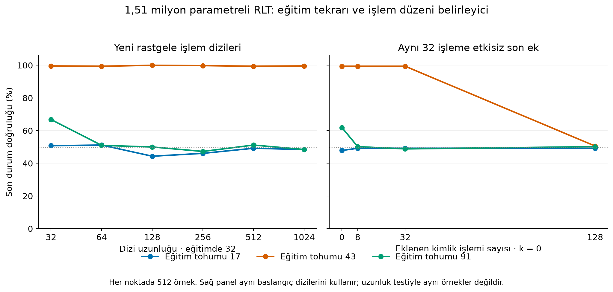

# Büyük yerel model: ölçek duyarlılığı ve uzun ufuk

Altı eğitim ve bütün önceden belirlenmiş testler tamamlandı. Bağımsız yeniden hesaplama PASS: 60 tahmin dosyası, 7.102.464 token hedefi, eşlenik ilk ağırlıklar/girdiler, doğrulama kaybına göre model seçimi, testten önce altı eğitimin tamamlanması ve sabitlenen kaynak dosyaları denetlendi. Bilimsel sonuç **MIXED**: üç RLT tekrarından yalnız biri kısa problemi güvenilir öğrendi ve ölçülen 1.024 adıma kadar korudu. Diğer ikisi aynı eğitim protokolünde kısa problemde bile %95 eşiğini geçemedi.

Protokol SHA256: `54ee3d844cd21435b98563c8ae5d077da9b498ba867c33e660ee992d72e9b41d`. Kaynaklar: `integration/scale/metrics.json`, `audit/scale-independent-audit.json`; bütün tahminler ve model ağırlıkları korunmuştur.

## Ne yapıldı?

Genişlik256, dört dikkat başı, bir encoder/bir decoder bloğu, yerel decoder penceresi4. RLT 1.512.706 etkin parametre kullanır. Geri besleme kapalı kontrolde aynı sayıda parametre ayrılır; 1.315.330'u kullanılan hesaplamaya katılır. Üç eşlenik tohum17/43/91, aynı başlangıç ağırlıkları, aynı örnekler ve aynı2.000 eğitim güncellemesi. Eğitim uzunluğu32; her token için doğru parite durumunu veren prefix gözetimi. Kontrol, global encoder belleğini ve yerel decoder dikkatini korur. Bu karşılaştırma eşit hesaplama bütçesi veya eşit kaliteye ulaşma süresi karşılaştırması değildir.

## Her eğitimin sonucu

Nihai durum doğruluğu, her hücrede512 yeni örnek:

| Model / tohum | 32 | 64 | 128 | 256 | 512 | 1.024 |
|---|---:|---:|---:|---:|---:|---:|
| RLT17 | %50,78 | %51,17 | %44,34 | %46,09 | %49,22 | %48,44 |
| RLT43 | %99,61 | %99,41 | %100 | %99,80 | %99,41 | %99,61 |
| RLT91 | %66,80 | %50,98 | %50,00 | %47,27 | %51,17 | %48,44 |
| Geri besleme kapalı17 | %51,37 | %51,37 | %46,48 | %46,68 | %51,17 | %46,29 |
| Geri besleme kapalı43 | %46,88 | %49,22 | %47,27 | %50,20 | %46,48 | %48,83 |
| Geri besleme kapalı91 | %48,44 | %49,61 | %49,02 | %50,59 | %49,41 | %50,98 |

Önceden tanımlanmış etkin ufuk, bütün önceki test noktaları da en az%95 ise atanır. Bu yüzden yalnız RLT43 için “test edilen1.024 adıma kadar” sonucu vardır. En iyi tohumu tek başına seçip üç eğitimden beklenen sonucu temsil ettiği söylenemez. Model seçimi final testine göre yapılmadı: en düşük doğrulama prefix kaybı kullanıldı.

## Cevabı değiştirmeyen işlemler

Ayrı512 başlangıç dizisinin sonuna aynı durumu koruyan token2 işlemleri eklendi. Bu, token zamanı t'yi artırır; başlık güncellemesi k hâlâ0'dır. Uzun kimlik son eki eğitimdeki rastgele karışımın dağılımını değiştirir; bu yüzden sonuç saf bir yerel başlık “fazla düşünme” deneyi olarak yorumlanamaz.

| RLT tohumu | +0 | +8 | +32 | +128 |
|---|---:|---:|---:|---:|
|17 | %47,85 | %49,22 | %49,22 | %49,22 |
|43 | %99,41 | %99,41 | %99,41 | %50,59 |
|91 | %61,91 | %50,20 | %48,83 | %50,20 |

Başarılı43 numaralı modelin rastgele uzun dizilerde yüksek doğruluğu, bütün işlem düzenlerinde kararlılık sağlamadı. Yürütme yolunun uzatılabilmesi, bilginin her ek geçişte korunması teoremi değildir.

## Gerçek maliyet ve sınırlar

RTX2060SUPER üzerinde float32 kullanıldı. RLT eğitimleri639,43–753,63s; geri beslemesiz eğitimler38,64–45,63s sürdü. Bunlar doğrulama aralıklarını içeren yerel duvar süreleridir; diğer CPU araştırma işleri aynı makinede çalıştı. RLT'nin ardışık yürütülmesi ve kontrolün paralel yürütülebilmesi bu farkın bir parçasıdır. Sabit adımda daha hızlı kontrolün test doğruluğu şans düzeyindedir; eşit kalitede hızlanma ölçülmedi.

Eğitimde PyTorch CUDA tepe ayrılmış bellek RLT için97,62MiB, kontrol için76,21MiB; tepe ayrılmış havuz sırasıyla120 ve94MiB. Bunlar toplam ekran kartı belleği veya eğitim boyunca yalnız aktivasyon belleği değildir. Enerji ölçülmedi. GPU bit düzeyinde deterministik çalıştırılmadı.

Genişlik artarken dikkat başı sayısı ve küçük modellerle karşılaştırıldığında cihaz değişti. Öğrenme oranı her ölçek için ayrı eniyilenmedi. Sonuç, bu sabit protokol altında ölçek duyarlılığıdır; RLT için evrensel ölçek yasası veya büyük modelin kapasite sınırı değildir. Bağımsız denetim saklanan sınıf tahminlerinden doğrulukları hesaplar; ham logitler saklanmadığı için çapraz entropi kaybını bağımsız yeniden hesapladığı iddia edilmez.

